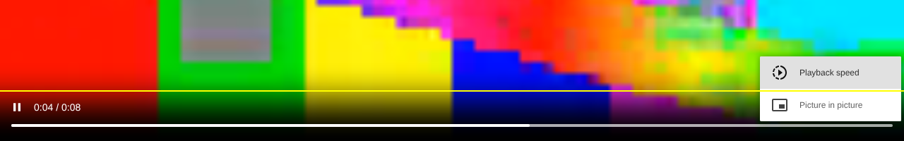
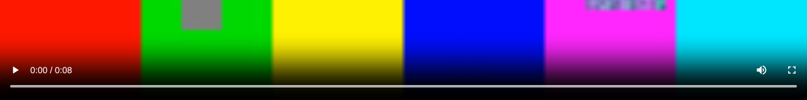

# Focus return: the player reports when an interaction ends, the adapter knows what the learner used last

Any click in the player would leave keyboard focus in the webview, which is a Focus change. Spec
#12 says the extension then refocuses "the editor or terminal that was active before", except
while the seek bar is being dragged. This ADR records how that works. Later work builds on it:
zoom gestures (#46, #47) and the other video spots (#49–#52). Source: spec #12 (_Focus return_,
the `userInteracted` event) and the orchestrator's answer on #23, which accepted this design and
added the gesture hold, the keyboard and the fallback below.

**The player decides when.** It posts `userInteracted {}` (no `lessonId`: it is about the page,
not a Lesson) at the end of each learner interaction. A Seam 2 probe of Chromium's native
`<video controls>` found that the control bar keeps its pointer events to itself. A click on its
buttons reaches no page listener, and neither does the `pointerup` that ends a seek-bar drag. So
the end of an interaction is read from what does reach the page:

- `pointerup` anywhere in the page: a click on the picture, which a transparent overlay above the
  control bar catches (and turns into play/pause at once, without the native player's wait for
  a double-click);
- `keyup` anywhere in the page: the learner tabbed to a native control and used it from the
  keyboard, so a keyboard-driven control never strands focus;
- `lostpointercapture` on the video: the learner let go of the seek bar or the volume slider;
- a change made by a control-bar button: a `play` the player did not start itself, a `pause` the
  extension did not ask for (not the Lesson's end), and `volumechange` (the player never changes
  the volume).

The overlay's own play/pause is marked as the player's, so one click posts one `userInteracted`.

**One mechanism holds a gesture that is not finished.** `Interactions` (`src/player/interactions.ts`)
posts on `ended()`, except between `beginGesture()` and `endGesture()`; `endGesture()` posts once.
The native slider uses it from `gotpointercapture` to `lostpointercapture`, so focus never leaves
mid-drag. A zoom-area drag (#46) and a pan (#47) begin and end their gestures the same way.

**The core decides that focus returns.** On `userInteracted` it calls `UiSink.returnFocus()`.

**The VS Code adapter knows where focus was.** The stable API cannot read which part has focus.
There is no way to read a context key, and `activeTextEditor` stays set while the terminal has
focus. So `FocusReturn` (`src/adapters/vscode/focus-return.ts`) remembers the last target from the
signals the API does give:

- an editor: a file or untitled text editor became active, its selection changed, or the active
  editor's document was edited;
- a terminal: a terminal became active, a shell command started in it, or it got its first input.

On `returnFocus` it shows that terminal with focus. For an editor, it focuses the editor showing
that document, but only while it is visible, so a tab behind the player is never brought in front
of it. If that editor is not visible, it focuses any visible code editor, so focus does not stay in
the player. With no code editor in sight it does nothing. The orchestrator suggested
`workbench.action.focusActiveEditorGroup` for that fallback, but after a click in the player the
active group is the player's own, so that command would leave focus in the player.

This is adapter code, not at a test seam: Seam 1 checks the decision (an interaction returns
focus) and the smoke test checks in real VS Code that a real click returns focus to the code
editor. The fallback and the terminal path are Manual QA.

**The smoke test clicks for real.** `scripts/run-smoke.mjs` opens a DevTools port, and the suite
clicks the middle of the player's `<iframe>` in the workbench page with Playwright over that port
(the webview's own frames are out of process and not listed there). Chromium routes the click into
the player as real input. VS Code's command line warns that it does not know the switch; that one
line is allowlisted.

## Considered options

- **Focus the first editor group** (the prototype's approach). Rejected: it ignores the terminal
  and any other layout.
- **Post `userInteracted` on `pointerdown`, or on the webview's `focus`.** Rejected: this fires at
  the start of a seek-bar drag and would end the drag.
- **Keep the last focus target and the choice of where to return in the core**, fed by adapter
  events and asking the adapter which targets are visible, through a new port. Rejected for now.
  The choice is small (terminal or editor, then which visible editor), but every input to it is
  workbench state that only the adapter can read: which part was used last, which editors are
  visible, in which group. The core would mirror that state through a port the spec does not
  list, and Seam 1 would then test a copy of VS Code's focus model rather than VS Code. So this is
  a recorded exception to "decisions live in the core", like `asWebviewUri`. If the choice grows
  (for example per video spot, #49–#52), it moves into the core behind that port.
- **Replace the native controls with our own.** Then every pointer event would be ours. Rejected
  for this ticket: it is far larger, and spec #12 keeps the native control bar.

## Consequences

- Known gap: if the learner clicks into a terminal that is already active and types without
  running a command (or the shell has no shell integration), the API reports nothing. A click in
  the player then returns focus to the editor. This is on the Manual QA list.
- **The native overflow menu is turned off** (`controlslist="nodownload noplaybackrate
noremoteplayback"`, `disablepictureinpicture`, `disableremoteplayback`). It opens about 120 px
  above the bottom, above the overlay's lower edge, so the overlay would cover its items and a
  click on "Playback speed" would toggle playback instead. Speed has FollowAlong's own controls
  (stories 41, 47), and the core must know the rate. The floating-window spot replaces
  picture-in-picture. Download does not apply to a local file. The control bar keeps play, time,
  mute, volume, fullscreen and the seek bar. The fullscreen button is not reported as an
  interaction.

  
  

- Chromium pauses a playing Lesson while the seek bar is scrubbed and plays it on release. The
  core receives `paused {byUser: true}` and then `played`, and the release can post
  `userInteracted` twice (the gesture's end, then the `play`). Focus returns twice to the same
  target, which is harmless. A Space on a focused native control posts twice in the same way.
- Any key released in the player returns focus, so the learner cannot tab through the native
  controls. FollowAlong's own controls are keybindings used from the Practice area, so nothing
  depends on that.
- `onDidChangeActiveTerminal` also fires for terminals that a task or another extension
  creates, so the target can become a terminal the learner never typed in. Returning focus to a
  terminal also reopens the panel if the learner has hidden it since. Both are on the Manual QA
  list.
- The prototype found that in the floating-window spot, returning focus raises the main window
  over the floating one. The ticket for that spot decides whether focus returns there.
- When a later ticket makes the player change the volume itself, it must mark that change as the
  player's, just as `play()` does, or `volumechange` will report it as the learner's.
- Seam 2's default harness posts with Playwright's `page.evaluate`, which counts as a user
  gesture, so there autoplay always works. `openPlayer(page, { userGestures: false })` posts as
  VS Code does, and Chromium then refuses autoplay as VS Code does (#12 D3).
