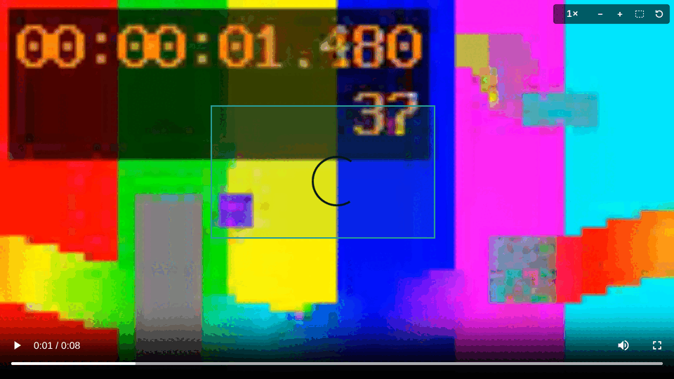
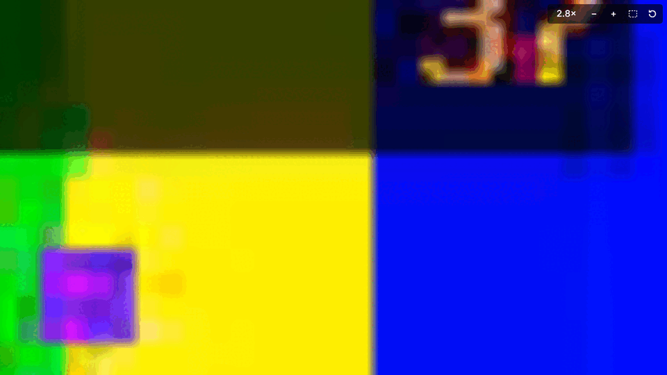

# Zoom to a dragged area: view state in the player, the level in the status bar

Spec #12 (stories 59, 61, 63, 64) asks for a box dragged on the picture to zoom to that area, a
double-click to reset, a toolbar (level, −, ＋, area, reset), a status bar item with the level that
resets on a click, zoom kept while the Lesson plays, and the native control bar hidden while zoomed.
It puts zoom in the webview's `getState`/`setState` and has the player report `zoomChanged
{level}`. These are the choices the spec left open. Source: #46, and the orchestrator's answers
Q1–Q4 on it, which accepted each default below.

- **Zoom belongs to the player page, not to the Lesson** (Q1). The player keeps what it shows as
  a level from 1 to 8 plus the top-left corner of the shown area, in fractions of the whole
  picture (`src/player/zoom.ts`). Fractions, not pixels, so a resized player (or, with #49, a
  moved one) still shows the same area. The video is scaled from its top left with a CSS
  transform whose translate is a percentage of its own box, so a resize needs no code. The view is
  written to the webview state on every change. So it stays while the Lesson plays, when the next
  Lesson loads (the instructor's editor is usually in the same place), and when VS Code reloads
  the page (ADR 0022). A reloaded page shows the stored zoom and reports it with `zoomChanged`
  after `ready`. A page at 1× reports nothing.
- **The core only shows the level.** It keeps the level the page last reported, 1 for a new page
  (on `ready`, a `show` that makes a page, or a close). It adds a `zoom` item after the back item
  of ADR 0018, only while the level is above 1. A click on the item runs the core command
  `zoomReset`: it sends `zoom {action: 'reset'}` and hands focus back, like the other items. The
  item goes when the player reports `zoomChanged {level: 1}`, because the player knows what it
  shows. `ZoomAction` is only `'reset'` for now; #48 adds `in`, `out` and `areaMode` for the keys.
- **`zoomChanged` carries no `lessonId`**, like `userInteracted`: it is about the page.
- **One label rule** (`zoomLabel` in the protocol module, used by the toolbar and the status bar
  item): one decimal, without a trailing `.0`: `1×`, `1.3×`, `2.4×`, `8×`. ＋ and − step by
  1.25× around the middle of what is shown. The level stops at 1 and at 8× (the prototype's
  maximum, beyond which the picture is only blur).
- **A drag is not a click** (#23). A press on the picture becomes a drag once the pointer moves
  more than 6 px. The drag draws a box. On release, a box of at least 12 px each way zooms as close
  as the whole box allows, centred on the box and kept inside the picture. The `click`
  that follows a drag does not play or pause. The drag is a gesture for Focus return (ADR 0009):
  `beginGesture` when it becomes a drag, `endGesture` on release, so focus is handed back once,
  when it ends.
- **A click waits for a double-click only while zoomed** (Q2). At 1× a click plays or pauses at
  once, as #23 made it, and a double-click has nothing to reset. While zoomed, a double-click
  resets, and must not play and pause on the way (with Rewind on, the second toggle would also
  step back). So a click on the zoomed picture plays or pauses 300 ms later, unless a second click
  follows: then nothing toggles and the double-click resets. A `load` cancels a click still
  waiting. The click reports `userInteracted` at once, like any click. Its toggle still runs
  within Chromium's user activation window, so the click that unlocks playback (#12 D3) works
  zoomed too. Seam 2 checks it with `userGestures: false` on a reloaded page that kept its zoom
  and has had no gesture yet.
- **A plain drag draws a box at any zoom, for now** (Q3). While zoomed it zooms further into the
  shown area. #47 changes this: a plain drag while zoomed pans, and Shift+drag draws a new box.
  **Area mode** (the toolbar's area button, `aria-pressed`) means the next drag draws a box,
  whatever the zoom. It ends after that box zooms, or on a second press. Until #47 it changes
  only the cursor, since every drag draws a box.
- **The native control bar is off while zoomed.** It would be magnified with the picture. The
  player sets `controls` to false, and the overlay then covers the whole player, so the strip
  along the bottom is picture: a click there plays or pauses. At 1× the bar and the overlay's
  72 px gap are as ADR 0009 describes. While zoomed the learner controls playback with the keys,
  the status bar and a click on the picture.
- **The toolbar** sits in the top right corner, above the click overlay and the Next overlay. It
  shows while the pointer is over the player (as the native bar does) and in area mode, so it
  does not cover the instructor's code the rest of the time. Its buttons are not the picture:
  they never play or pause. A press hands focus back like any click.

## Considered options

- **Reset zoom on every Lesson load.** Rejected (Q1): the spec puts zoom in view state, story 55
  keeps it across a move of the player, and the next Lesson usually shows the same editor.
- **Always wait for a possible double-click before a click plays or pauses.** Rejected: it would
  slow the most common click (#23 made it instant), and at 1× there is nothing to reset.
- **Toggle at once and undo the first toggle on a double-click.** Rejected: the learner would hear
  a blip, and the core would record a manual pause and a play.
- **Keep the zoom in pixels, as the prototype did.** Rejected: a resize would show another area,
  and a stored view would not fit a player of another size.
